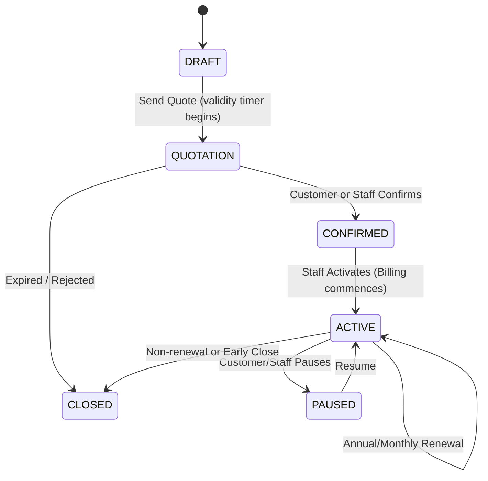

# Brightloop User & Operations Guide

Brightloop is an end-to-end Subscription Management, Billing, and Revenue Operations platform built for high-velocity B2B recurring revenue operations.

This guide walks you through the core workflows, role permissions, and system features.

---

## 1. Role-Based Access Control (RBAC)

Brightloop enforces strict internal and external separation across three primary roles:

```
[ ADMIN ]      --> Full access: Staff onboarding, catalog & tax setup, platform diagnostics, analytics.
[ STAFF ]      --> Operations: Quotations, subscription contracts, batch billing, payment logging.
[ CUSTOMER ]   --> External portal: View personal contracts, approve quotes, inspect invoices & print receipts.
```

---

## 2. Core Workflows & Step-by-Step Walkthrough

### Step 1: Login & Authentication
1. Navigate to `http://localhost:5173/login`.
2. Enter your credentials:
   - **Admin Account**: `admin@brightloop.local` / `Admin@Brightloop2026!`
   - **Staff Account**: `staff@brightloop.local` / `Staff@Brightloop2026!`
   - **Customer Account**: `customer1@brightloop-client.com` / `ClientPass123!`
3. Once logged in, your JWT session is managed automatically with Bearer token authentication.

---

### Step 2: Executive Finance Dashboard (`/dashboard`)
*Available to: Admin, Staff*

- **KPI Cards**:
  - **Active Subscriptions**: Live count of confirmed recurring contracts.
  - **Monthly Recurring Revenue (MRR) / Total Billed**: Exact cents converted to formatted currency.
  - **Outstanding Accounts Receivable (AR)**: Net balance pending across unpaid invoices.
  - **Overdue Invoices Alert**: Immediate tally of delinquent accounts past payment terms.
- **Aging Analysis Buckets**:
  - `0 - 30 Days`
  - `31 - 60 Days`
  - `61 - 90 Days`
  - `90+ Days (Critical)`
- **Interactive Revenue Chart**: Monthly cash collection trend lines.

---

### Step 3: Catalog & Pricing Setup (`/admin/products`, `/admin/plans`)
*Available to: Admin*

1. **Products & Variants**:
   - Products are categorized as `SOFTWARE`, `HARDWARE`, or `SERVICE`.
   - Add product variants with price differentials (e.g., `Brand: Odoo Connector` adding `+₹560.00`).
2. **Subscription Plans**:
   - Define billing cadence: `MONTHLY` or `YEARLY`.
   - Set business constraints: `Min Quantity`, `Allow Pause`, `Allow Early Close`, `Allow Renewal`.
3. **Discounts & Coupons**:
   - Create percentage (`10%`) or fixed-amount (`₹500`) discounts.
   - Enforce usage limits, expiration dates, and minimum cart amounts.
4. **Tax Rules**:
   - Configure jurisdictional rules like `GST 18%` (inclusive or exclusive).

---

### Step 4: Quotation Templates & Draft Subscriptions (`/staff/quotation-templates`)
*Available to: Admin, Staff*

1. **Quotation Templates**:
   - Reusable bundles for standard commercial packages (e.g., "Enterprise Cloud Bundle").
2. **Convert Template to Contract**:
   - Click **"Convert to Quotation"** on any template.
   - Select the target Customer and starting date.
   - A new contract draft is generated instantly with calculated unit prices, line subtotals, and payment terms (`NET30`).

---

### Step 5: Subscription State Machine Lifecycle (`/staff/subscriptions`)
*Available to: Admin, Staff, Customer (Self-Service)*

Contracts advance through a strict finite state machine:



- **Send Quotation**: Locks terms and sets expiration date (default 30 days).
- **Confirm**: Customer accepts quotation terms.
- **Activate**: Subscription becomes active and is queued for automated batch billing.
- **Pause / Resume**: Customer self-service or staff override (respecting plan permissions).
- **Close**: Cancels or finishes contract.

---

### Step 6: Automated Recurring Batch Billing (`/staff/invoices`)
*Available to: Admin, Staff*

1. Navigate to the **Invoices** view.
2. Click **"Run Billing Cycle"**:
   - The billing engine executes an atomic pass across all `ACTIVE` subscriptions.
   - It computes current periods (`billing_period_start` to `billing_period_end`).
   - **Idempotency Guard**: A composite database unique constraint `(subscription_id, billing_period_start)` prevents duplicate invoicing even if triggered repeatedly.
   - Returns number of new invoices generated and total value billed.

---

### Step 7: Invoice Settlement & Payment Recording
*Available to: Admin, Staff*

1. Open any invoice in `CONFIRMED` or `OVERDUE` status.
2. Click **"Record Payment"**:
   - Select method: `BANK_TRANSFER`, `CREDIT_CARD`, `UPI`, `CASH`, or `CHEQUE`.
   - Enter amount paid in cents/paise and optional reference notes.
   - The invoice balance due recalculates in real time.
   - When balance reaches zero, the invoice status automatically updates to `PAID`.
3. **Printable Invoice**:
   - Click the **Print** icon to launch a clean, standalone, printable HTML tax invoice with customer details, breakdown of variant items, taxes, discounts, and payment history.

---

### Step 8: Customer Self-Service Portal (`/portal/subscriptions`, `/portal/invoices`)
*Available to: Customer*

1. Log in with a customer account (e.g., `customer1@brightloop-client.com`).
2. Customers have isolated access restricted strictly to their own entity:
   - **My Subscriptions**: View active licenses, renewal dates, and perform self-service actions (Confirm quote, Pause, Resume).
   - **My Invoices**: Review payment status, download receipts, and view payment balances.
   - **Forbidden Barrier**: Direct attempts by customers to access administrative URLs or API endpoints return immediate `403 Forbidden` responses.
